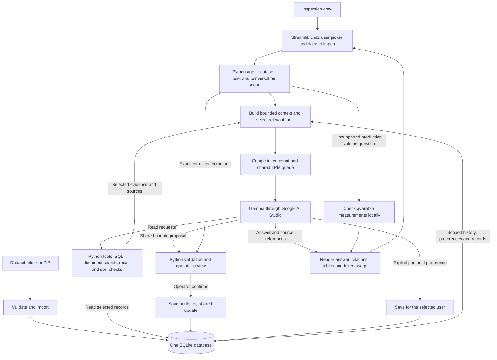

# Asset Intelligence Copilot

A chat copilot for oil-field inspection teams, built with Python, Streamlit, SQLite and Gemma. It answers questions from inspection records, maintenance reports, operating procedures and crew notes.

The copilot shares well updates across users and keeps each user's conversations and preferences private. Original records remain available after a correction.

## Quick start

Use Python 3.11 or newer. Run these commands from the project root:

```bash
python -m venv .venv
```

Activate the environment with `.venv\Scripts\Activate.ps1` on Windows PowerShell
or `source .venv/bin/activate` on macOS/Linux, then install dependencies and fetch
the dataset:

```bash
python -m pip install -r requirements.txt
git clone https://github.com/FlytBaseAILabs/flytbase-ahc-swe-asset-intelligence-dataset.git challenge-dataset
```

Skip the clone if `challenge-dataset/` already exists. Copy `.env.example` to
`.env`, set `GOOGLE_API_KEY`, and start the app:

```bash
python -m streamlit run app.py
```

Open `http://localhost:8501`. The first run imports the sample field automatically.
The sidebar accepts other dataset folders or ZIPs without replacing existing
imports. `.env`, datasets and the local database are excluded from Git.

For the released test field, set these values in `.env`, import the folder through
the sidebar, and select it:

```dotenv
COPILOT_DATASET_PATH=challenge-dataset/test-data/dataset
COPILOT_AS_OF_DATE=2027-01-15
COPILOT_REPORT_DATE=2027-01-15
```

Private conversation dates always use the real clock. The report date affects
operational relative dates only. See `.env.example` for provider, token-budget
and storage settings.

## Tests

With both sample and test data available in `challenge-dataset/`, run:

```bash
python -m unittest discover -s tests
```

The suite uses isolated databases and fake provider responses; it makes no live
model requests. Imports, the data browser and visual previews also work without
an API key. The crew selector is a demo identity mechanism, not authentication.

## Documentation

- **[Project report](report.md)** — system design, rate limits, optimization, and before/after screenshots.
- **[Architecture](docs/architecture.md)** — module guide, request flow, safety boundaries and current limits.
- **[Database and memory schema](docs/application-schema.md)** — SQLite tables and their relationships.
- **[Source data map](docs/data-map.md)** — sample dataset fields, joins and domain rules.
- **[Q8 demo](docs/q8-demo.md)** — shared reports, private preferences and attribution.

## System architecture



**Retrieval:** SQL handles structured records. Keyword search retrieves document passages. The recall and spill tools collect related records and rules together. Only selected evidence enters the model context.

**Memory:** All memory uses the same SQLite database, with separate tables and enforced scopes:

- Shared notes, corrections and replacement reports belong to a dataset and well or inspection.
- Private conversations and preferences belong to a dataset and user. Conversation history also has a session ID.
- Pending shared updates require confirmation. Private display preferences save after an explicit instruction.

**Model calls:** Complete recall and spill checks normally need two rounds. Other requests can use up to three. Fully specified corrections and unsupported production-volume questions can use local paths without model generation.

**Rate control:** A persistent ledger coordinates Google input tokens across app users and conversations. The configured 16,000 TPM allowance uses a 14,500-token working budget, plus conservative reservations for each attempt. Requests wait when the budget is full. External requests from other programs remain outside this ledger.

**Data limits:** Temperature readings classify production status; they do not measure oil volume. The copilot states missing evidence rather than inventing a production ranking. The current retrieval uses SQL and keyword search; it has no vector or graph database.
