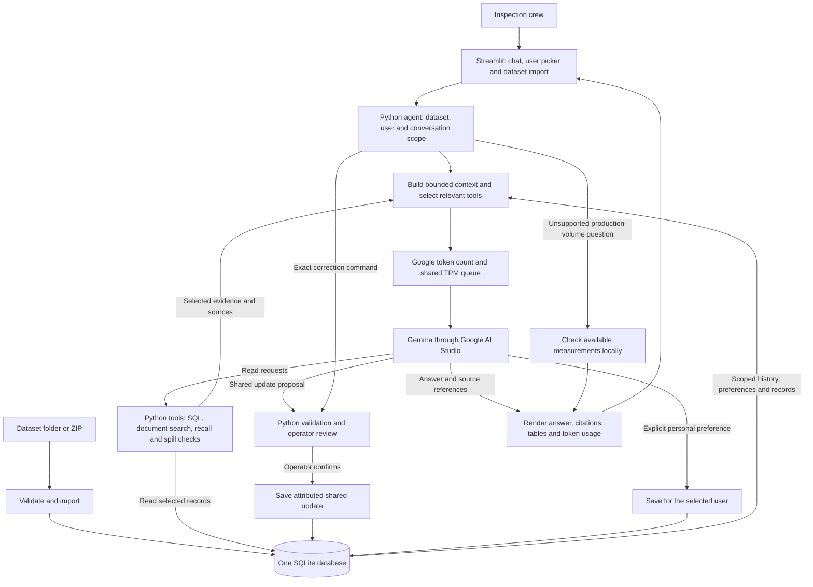

# Asset Intelligence Copilot

A chat copilot for oil-field inspection teams, built with Python, Streamlit, SQLite and Gemma. It answers questions from inspection records, maintenance reports, operating procedures and crew notes.

The copilot shares well updates across users and keeps each user's conversations and preferences private. Original records remain available after a correction.

## Reports

- **[Project report](report.md)** — system design, rate limits, optimization, and six screenshots showing the results before and after the changes.
- **[Database and memory schema](docs/application-schema.md)** — Mermaid diagram of the SQLite tables and their relationships.

## System architecture

**Retrieval:** SQL handles structured records. Keyword search retrieves document passages. The recall and spill tools collect related records and rules together. Only selected evidence enters the model context.

**Memory:** All memory uses the same SQLite database, with separate tables and enforced scopes:

- Shared notes, corrections and replacement reports belong to a dataset and well or inspection.
- Private conversations and preferences belong to a dataset and user. Conversation history also has a session ID.
- Pending shared updates require confirmation. Private display preferences save after an explicit instruction.

**Model calls:** Complete recall and spill checks normally need two rounds. Other requests can use up to three. Fully specified corrections and unsupported production-volume questions can use local paths without model generation.

**Rate control:** A persistent ledger coordinates Google input tokens across app users and conversations. The configured 16,000 TPM allowance uses a 14,500-token working budget, plus conservative reservations for each attempt. Requests wait when the budget is full. External requests from other programs remain outside this ledger.

**Data limits:** Temperature readings classify production status; they do not measure oil volume. The copilot states missing evidence rather than inventing a production ranking. The current retrieval uses SQL and keyword search; it has no vector or graph database.
