# SQLite schema: source records and memory

Updated 23 October 2026. The application defines 17 tables, 176 declared columns, and 15 declared foreign keys in the same SQLite file, `data/copilot.sqlite3`.
This chart shows the main tables and selected fields. It is an application schema, not the source-file inventory.

- **Shared memory:** `context_notes`, `corrections`, and `equipment_replacement_reports`.
- **Private memory:** `chat_messages` and `user_preferences`.
- **Review state:** `pending_updates`. A shared proposal is not an accepted fact before confirmation.
- **Original evidence:** `inspections`, `maintenance`, and the other imported source tables.

Every source or memory relationship also uses `dataset_id`, even when the line label shows only the record ID.
Private reads additionally require the selected `user_id`; conversation reads can also require `session_id`.

Normal initialization removes only the obsolete `model_token_reservations` and
`model_rate_limit_cooldowns` tables and their owned indexes. This idempotent upgrade
keeps operational records, chats, preferences, replacement reports and pending
proposals. Development tests do not open or migrate the live database.

Lines show logical joins. Most record references are checked by Python, not declared as SQLite foreign keys.
Dataset foreign keys and the shown primary keys are declared in SQLite.

```mermaid
erDiagram
    datasets {
        TEXT dataset_id PK
        TEXT label
        TEXT source_path
        TEXT as_of_date
    }
    areas {
        TEXT dataset_id PK
        TEXT area_id PK
        TEXT team_id
        TEXT name
    }
    teams {
        TEXT dataset_id PK
        TEXT team_id PK
        TEXT lead_user_id
    }
    users {
        TEXT dataset_id PK
        TEXT user_id PK
        TEXT name
        TEXT role
        TEXT team_id
    }
    wells {
        TEXT dataset_id PK
        TEXT asset_id PK
        TEXT area_id
        TEXT team_id
        TEXT in_charge_user_id
        TEXT well_type
    }
    equipment {
        TEXT dataset_id PK
        TEXT equipment_id PK
        TEXT asset_id
        TEXT kind
        TEXT model
    }
    inspections {
        TEXT dataset_id PK
        TEXT inspection_id PK
        TEXT asset_id
        TEXT inspector_user_id
        TEXT inspected_at
        REAL wellhead_temp_c
        REAL ambient_temp_c
        INTEGER spill_detected
    }
    maintenance {
        TEXT dataset_id PK
        TEXT maintenance_id PK
        TEXT asset_id
        TEXT technician_user_id
        TEXT triggered_by_inspection_id
        TEXT report_file
        REAL cost_total
    }
    regulatory_events {
        TEXT dataset_id PK
        TEXT event_id PK
        TEXT asset_id
        TEXT related_inspection_id
        TEXT protocol_id
    }
    documents {
        TEXT dataset_id PK
        TEXT document_id PK
        TEXT path
        TEXT kind
        TEXT asset_id "optional well link"
        TEXT body "SOPs, manuals and reports"
    }
    well_types {
        TEXT dataset_id PK
        TEXT well_type PK
        REAL production_delta_c
        TEXT manual_document_id
    }
    context_notes {
        TEXT dataset_id PK
        TEXT note_id PK
        TEXT asset_id
        TEXT author_user_id
        TEXT inspection_id "optional"
        TEXT note_type
        TEXT text
        TEXT valid_from
        TEXT valid_to
        TEXT origin "dataset or runtime"
    }
    corrections {
        TEXT correction_id PK
        TEXT dataset_id
        TEXT inspection_id
        TEXT field
        TEXT value_json
        TEXT author_user_id
        TEXT reason
        TEXT status "accepted or disputed"
        TEXT source_note_id
        TEXT feedback_kind
    }
    equipment_replacement_reports {
        TEXT report_id PK
        TEXT dataset_id
        TEXT asset_id
        TEXT reported_by_user_id
        TEXT claimed_source_user_id "optional named source"
        TEXT evidence_basis "direct_report or hearsay"
        TEXT status "reported_replaced or unconfirmed"
        TEXT effective_on
        TEXT statement
        TEXT source_note_id
    }
    chat_messages {
        INTEGER message_id PK
        TEXT dataset_id
        TEXT user_id
        TEXT session_id
        TEXT role
        TEXT content
        TEXT payload_json "sources and usage metrics"
        TEXT created_at
    }
    user_preferences {
        TEXT dataset_id PK
        TEXT user_id PK
        TEXT preferences_json
        INTEGER source_message_id
        TEXT updated_at
    }
    pending_updates {
        TEXT pending_id PK
        TEXT dataset_id
        TEXT user_id
        TEXT session_id
        TEXT tool_name
        TEXT arguments_json
        TEXT status "pending, processing, saved or cancelled"
        TEXT result_json
    }

    datasets ||--o{ areas : scopes
    datasets ||--o{ teams : scopes
    datasets ||--o{ users : scopes
    datasets ||--o{ wells : scopes
    datasets ||--o{ documents : scopes
    teams ||--o{ users : team_id
    teams ||--o{ areas : default_team
    teams ||--o{ wells : current_team
    users ||--o{ teams : lead_user_id
    areas ||--o{ wells : area_id
    users ||--o{ wells : in_charge_user_id
    wells ||--o{ equipment : asset_id
    wells ||--o{ inspections : asset_id
    wells ||--o{ maintenance : asset_id
    wells ||--o{ regulatory_events : asset_id
    wells o|--o{ documents : optional_asset_id
    well_types ||--o{ wells : well_type
    documents ||--o{ well_types : manual_document_id
    users ||--o{ inspections : inspector_user_id
    users ||--o{ maintenance : technician_user_id
    inspections o|--o{ maintenance : triggered_by_inspection_id
    inspections o|--o{ regulatory_events : related_inspection_id
    wells ||--o{ context_notes : shared_well_context
    users ||--o{ context_notes : author_user_id
    inspections o|--o{ context_notes : optional_inspection_id
    inspections ||--o{ corrections : overlay_original
    users ||--o{ corrections : author_user_id
    context_notes o|--o{ corrections : source_note_id
    wells ||--o{ equipment_replacement_reports : shared_replacement_claim
    users ||--o{ equipment_replacement_reports : actual_reporter
    users o|--o{ equipment_replacement_reports : claimed_source
    context_notes o|--o{ equipment_replacement_reports : source_note_id
    users ||--o{ chat_messages : private_dataset_user_scope
    users ||--o| user_preferences : private_across_sessions
    chat_messages o|--o{ user_preferences : source_message_id
    users ||--o{ pending_updates : review_owner

```

## Read behavior

`effective_inspections` and `latest_inspections` are computed views in the local read snapshot.
They combine original measurements with accepted corrections and the well-type threshold.
They do not replace the original inspection rows.

SOPs, manuals and repair reports are records in `documents`. There is no separate SOP table.
Document search ranks keyword matches directly from these records.
The model-readable SQL snapshot excludes private chats, private preferences and review state.

## Write behavior

1. Gemma selects a controlled write tool.
2. Python validates the target, value, date and selected user.
3. Python stores a pending proposal for that user's review.
4. Confirmation saves the shared note, correction or replacement report.
5. Later reads retrieve the saved shared record for other users in the dataset.

Private formatting preferences save only for the selected dataset and user. They survive a new conversation.
A secondhand replacement report keeps its actual reporter and named source separate. It remains unconfirmed.
Original inspection and maintenance records remain available after a correction or report is saved.
