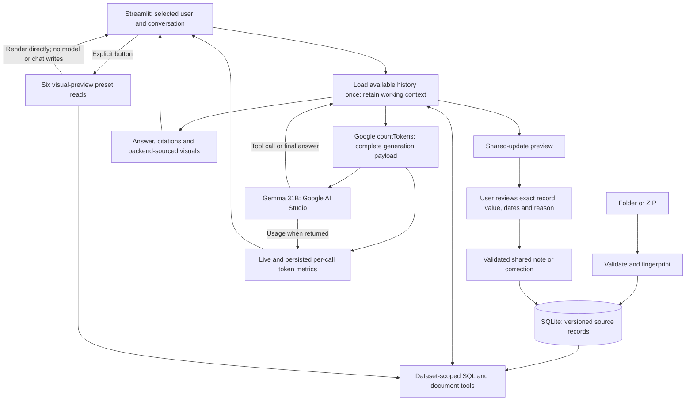

# Architecture: iteration 1

Status: implemented local first iteration, 17 October 2026. The broader source
model is documented in [data-map.md](data-map.md), and decisions in
[decision-log.md](decision-log.md). See [README](../README.md) for launch commands.

## Components

| Component | Implementation |
| --- | --- |
| UI | Streamlit: chat, users/conversations, imports, evidence, visuals, data browser |
| Durable storage | SQLite at data/copilot.sqlite3; original JSON and source locations retained |
| Ingestion | Atomic additive folder/ZIP import with content fingerprint and reference validation |
| Read tools | Well status, isolated SELECT, document search/read, selected user's prior chats |
| Write tools | Shared well note and inspection-field correction, reviewed before persistence |
| Model | Local configuration selects Google AI Studio gemma-4-31b-it again; the OpenRouter free adapter is retained |
| Token accounting | Full Google countTokens preflight, returned usageMetadata, live per-call UI and persisted counters |
| Visual preview | Six explicit database-backed presets with no model requests or chat writes |
| Orchestrator | Bounded native tool-call loop with server-scoped identity and source-backed visuals |

There is one running application and one persistent local SQLite database.
Business logic is independent of Streamlit. No separate API server, embedding
service, or graph server is needed for the initial demo.

The detailed [implemented request walkthrough](implemented-architecture.md) and
[interactive architecture view](implemented-architecture.html) distinguish backend
rules from model-selected SOP retrieval and explain the exact context boundary.

## Data flow

Native request/response contracts are tested offline. Earlier checks returned
Google HTTP 500 and upstream OpenRouter HTTP 429. A later real-user spill-heatmap
request completed two Google Gemma 31B rounds, with provider input counts of
3,556 and 7,135 tokens, and produced the heatmap. This verifies that request path,
not every scenario or citation. Local well reads can still produce a sourced
partial response during provider errors. Model size does not establish durable memory.

## Data and documents

Structured tables: datasets, areas, teams, users, wells, equipment, inspections,
maintenance, regulatory_events, context_notes, and well_types. Every source
record includes original JSON, dataset ID, source path and line where available.
Nested coordinates and costs have queryable columns; their original nesting is
preserved in raw_json. Document bodies are stored in documents with dataset-
relative paths, kind, well/type association and stable IDs. An optional FTS5
index is populated; current document tools use lexical passage ranking.

Initial sample: 200 wells, 39,567 inspections, 5,665 maintenance records, 90
regulator events, 141 context notes, 1,094 equipment entries and 1,514 documents.
Source checkout revision: b8de8c9bd68f40334e5d06922126169e4f3bf3ca.

The importer derives each used well-type threshold from its manual. It rejects
ambiguous or missing production-rule wording rather than guessing from sample
answers. Test coverage includes a new type with a different threshold.

## Ingestion and dataset identity

A ZIP or local folder runs through the same importer. A containing repository
folder is accepted when it contains exactly one dataset root. Source identifiers,
cross-well links, dates, report paths and SOP protocol references are validated
before the transaction commits. Upload paths, symlinks, sizes and expanded file
counts are bounded. Source evidence survives removal of temporary ZIP files.

Each package gets a deterministic content-derived dataset_id. Identical imports
reuse the dataset; changed imports become separate selectable versions. This
supports loading test data alongside sample data without deleting either. Notes,
corrections and conversations are also dataset-scoped. Automatic lineage-based
merging and note carry-forward are not implemented.

## Exact calculations and retrieval boundary

The model requests records through Python tools, not unrestricted SQLite access.
A SQL call creates an in-memory snapshot containing only the selected dataset's
public records. Private messages, pending updates and other datasets are never
copied. The snapshot has a read-only authorizer, function allowlist, execution
budget and output cap. Aggregation occurs over every matching row before the
300-row result cap. Graph or other retrieval tools can be added behind this
boundary in a later iteration.

The effective_inspections view combines source readings, manual thresholds and
accepted corrections. It retains raw columns and exposes explicit effective
values, temperature_delta_c, is_producing, corrected spill values and correction
source IDs. latest_inspections selects observations on or before the analysis date.
Production downtime is 7 times the count of nonproducing weekly inspections in
the requested period. A missed inspection adds zero. Repair downtime_hours
remains a separate field.

Document lookup retrieves actual imported Markdown, including the report path
stored on maintenance. Search returns numbered excerpts. Source citation IDs are
assigned by the server. Queries include their SQL and attached source references. A known citation defect
attaches production manuals whenever `well_types` is accessed, even for spill-only
queries against the effective view. These references do not support spill counts.
The T350 reference starts on blank line 23 before the rule on lines 24–26. SOP
retrieval is model-selected, without a mandatory context or policy gate.
Visual specifications reference a tool-result ID; the server supplies chart data
from that result and ignores model-invented data rows.

## Two memory scopes and updates

Private chat_messages are keyed by dataset, user and conversation. The current
prompt is saved, then up to 16 available individual user/assistant messages are
loaded once per request, including that prompt. The provisional cap is not based
on benchmarks, relevance scoring or a token-budget allocator. Every model round
resends retained instructions, schema, dates, history and tools, appending this
request's assistant tool calls and replies. History is not reloaded in each round.
The evidence panel shows tool provenance, not the full prompt.
`search_my_conversations` retrieves only the selected
user's earlier messages across sessions, with date/keyword/well filters and cursor
pages beyond the latest 30. Relative periods use field-local runtime TODAY, never
the dataset analysis date. Weeks start Monday; full local days are converted to
exact UTC [start, end) bounds. The challenge's user picker is a demo identity
mechanism, not production authentication.

Shared context_notes are loaded from every well's source context.jsonl and can
also be created at runtime. Notes are attributed claims with applicable dates.
Ordinary chat is persisted privately but is not automatically promoted to shared
knowledge. Explicit reports and correction requests can produce a server-stored
pending_updates record, bound to the user, dataset and conversation. The UI shows
a concrete preview, including original values and the proposed replacement.
Confirmation uses server-stored arguments, ignores edited preview arguments,
and is idempotent on a completed proposal. Cancellation is persistent.

Runtime corrections retain inspection, field, replacement value, author, reason
and accepted/disputed status in corrections; each links to a shared context note.
An additive feedback_kind classifies typed corrections as sensor readings, AI
detections or AI estimates. Classification never grants acceptance or creates
type-wide rules. Ordinary operator_feedback notes remain attributed context.
Raw inspections remain immutable. Imported formal false-positive notes override
their target detections per Spill Response SOP section 7 and do not contribute
to spill statistics. Ordinary opposing notes do not override a detection.
Competing correction values are disputed rather than silently choosing a winner.
An imported false-spill correction also cannot be silently reversed by a new
positive spill assertion.

The initial write policy asks a reviewer to attest the correction is verified
and they are qualified; it does not invent a source-defined role allowlist. A
formal authorization matrix and dispute-resolution UI remain future work. A
process crash during confirmation can leave a proposal marked processing; this
first iteration does not implement automated crash recovery.

## Time and uncertainty

Analysis defaults to the benchmark's 16 October 2026. New relative-date reports
use the app's field-local runtime date. Field timezone is configured once, with
UTC as an explicit configurable default. Date-only plan ends are inclusive in
this iteration. Source UTC timestamps remain unchanged. A maintenance plan's
expiry does not prove completion or restart, and a weekly inspection is not
presented as a live reading. Conflicting claims and stale recorded_status must
be disclosed with their evidence.

## Token accounting and model-free visual checks

Before each Google model round, a separate bounded
`countTokens.generateContentRequest` call measures the complete generation
payload: system instructions, schema, history, tools, replies and retrieved
SOP/document text. Counting failure never blocks inference. Returned
`usageMetadata.promptTokenCount` supersedes the preflight count when provided.
Live UI counters persist with the selected user's assistant response, including
errors. Missing counts remain Unavailable. Peak context is the largest single
input window, not the sum across repeated calls. One count request is made per
model round, without repetition for inference retries. A model round permits at
most three inference HTTP attempts for transient errors. A 429 or invalid key is
not automatically retried.

Visual preview runs six explicit read-only presets through the same tools and
renderers: status, temperature trend, downtime ranking, corrected-spill heatmap,
map and table. Only Show preview triggers the read. This path performs no model
or tokenization calls and writes no chat. It verifies local data and rendering,
rather than LLM tool selection.

## Verification and next increments

The automated suite covers ingestion/rollback, new manual thresholds, reference
sample production/spills/downtime/rankings, raw-data preservation, correction
propagation/disputes, SQL isolation and read-only limits, private history,
provider payloads, token accounting, scoped review/confirmation/cancellation,
private date-window recall and Streamlit flows. Provider tests replace the network
boundary. The successful live heatmap does not validate model quality across all
18 challenge scenarios.

Next increments can add type-wide rule memory, explicit dispute resolution,
dataset-lineage merging, production identity/authorization, or a graph retriever
if a measured question benefits from relationship traversal. All retrieval
methods must retain evidence, temporal meaning, correction precedence and user
boundaries.
