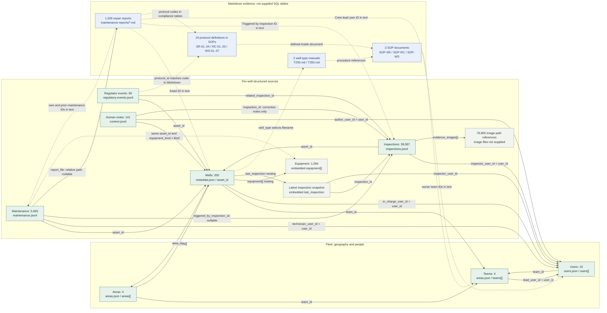
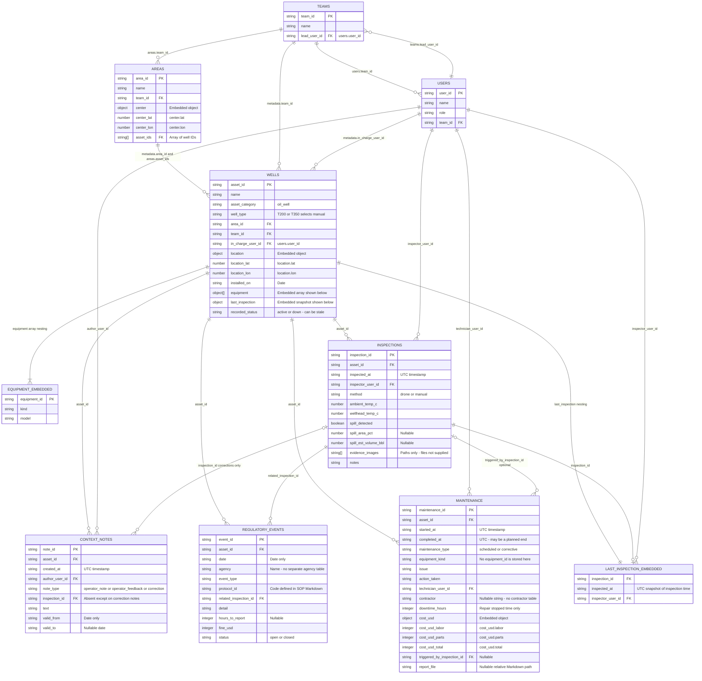
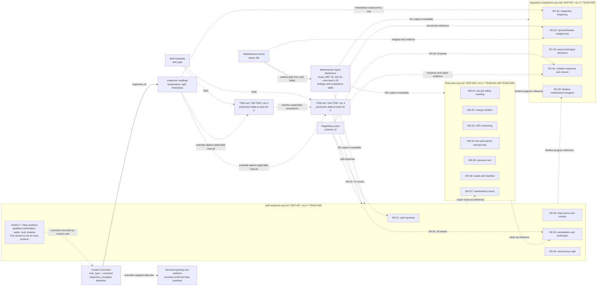
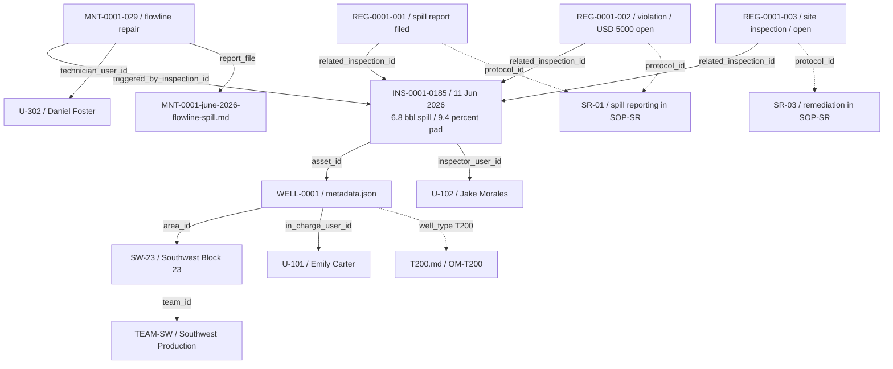
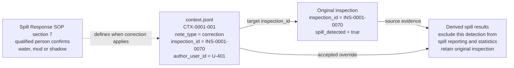

# Complete source data map

**Current application database:** see the [SQLite schema with shared and private memory](application-schema.md)
and its [editable Mermaid source](application-schema.mmd). That chart includes the new runtime memory and rate-limit tables.
The source inventory below describes the original sample release.

Inspected: 17 October 2026. Source revision: `b8de8c9bd68f40334e5d06922126169e4f3bf3ca`.

This maps the supplied data as it exists. The source is JSON, JSONL, and Markdown;
there are no supplied SQL tables. Boxes represent logical record groups, embedded
structures, or documents. This is not an application database migration.

**The well hub is `asset_id`. No single field exists in every source.** Geography,
people, manuals, and SOPs connect through additional identifiers and documented
lookups. Start with the overview, then the complete field diagram and SOP map.

- [Browsable schema explorer](data-map.html)
- [Rendered overview SVG](data-relationships.svg) / [editable Mermaid](data-relationships.mmd)
- [Rendered field ER diagram SVG](data-fields.svg) / [editable Mermaid](data-fields.mmd)
- [Rendered SOP/document diagram SVG](data-documents.svg) / [editable Mermaid](data-documents.mmd)
- [Machine-readable audit of every record and field](data-schema-inventory.json)

## Sources and actual counts

| Logical group | Physical source under sample-data | Actual count |
| --- | --- | ---: |
| Areas / geography | `fleet/areas.json` -> `areas[]` | 4 |
| Teams | `fleet/areas.json` -> `teams[]` | 4 |
| Users | `fleet/users.json` -> `users[]` | 15 |
| Wells | `assets/*/metadata.json` | 200 |
| Equipment | `metadata.json` -> `equipment[]`, embedded in wells | 1,094 |
| Latest-inspection snapshots | `metadata.json` -> `last_inspection`, embedded object | 200 |
| Inspection observations | `assets/*/inspections.jsonl` | 39,567 |
| Maintenance / repairs | `assets/*/maintenance.jsonl` | 5,665 |
| Regulatory events | `assets/*/regulatory-events.jsonl` | 90 |
| Human context notes | `assets/*/context.jsonl` | 141 |
| Well-type manuals | `fleet/well-types/T200.md`, `T350.md` | 2 |
| SOP documents | `fleet/sops/*.md` | 3 |
| Protocol definitions | Rows inside those 3 SOP documents | 16 |
| Repair reports | `assets/*/maintenance-reports/*.md` | 1,509 |
| Inspection image references | `inspections.evidence_images[]`; images omitted | 79,805 paths |

119 wells are T200 and 81 are T350. Every area has 50 wells. Only TEAM-SW and
TEAM-NE own geographic areas; maintenance and HSE teams also exist. Repairs are
4,156 scheduled and 1,509 corrective. Notes include 56 corrections, 82 operator
notes, and 3 operator feedback records.

## Overview: every source and its common links

For this flowchart, solid arrows show stored IDs, paths, or nesting. Dotted
arrows show document extraction, filename conventions, or logical/textual
relationships. SOP protocol targets exist in Markdown, not in a supplied table.



## Exact join and lookup keys

Arrow direction below means the source holds a reference to the target. PK/FK
labels in the field diagram are logical identifiers and references verified in
files; no database constraints have already been created.

| Source field / path | Target | Meaning / qualification |
| --- | --- | --- |
| `metadata.asset_id` | All per-well JSONL `asset_id` fields | Central well ID; not present on fleet users/manuals/SOPs |
| `metadata.area_id` | `areas[].area_id` | Well's geographic area |
| `areas[].asset_ids[]` | `metadata.asset_id` | Redundant list of wells belonging to an area |
| `areas[].team_id`, `metadata.team_id`, `users[].team_id` | `teams[].team_id` | Area owner, well owner, user team respectively |
| `teams[].lead_user_id` | `users[].user_id` | Team lead |
| `metadata.in_charge_user_id` | `users[].user_id` | Well's responsible person |
| `inspections.inspector_user_id` | `users[].user_id` | Person who performed the inspection |
| `maintenance.technician_user_id` | `users[].user_id` | Repair technician |
| `context.author_user_id` | `users[].user_id` | Author of a note/correction |
| `metadata.last_inspection.inspection_id` | `inspections.inspection_id` | Duplicated latest-inspection snapshot, not a separate observation |
| `metadata.last_inspection.inspector_user_id` | `users[].user_id` | Inspector copied into the snapshot |
| `maintenance.triggered_by_inspection_id` | `inspections.inspection_id` | Nullable: all 1,509 corrective jobs have it; scheduled jobs do not |
| `regulatory.related_inspection_id` | `inspections.inspection_id` | Present on all 90 regulator events |
| `context.inspection_id` | `inspections.inspection_id` | Only 56 correction notes have this key; other notes omit it |
| `metadata.well_type` | `fleet/well-types/{well_type}.md` | Type code selects a manual by filename convention |
| `maintenance.report_file` | Path relative to the owning well directory | Actual report path, nullable; do not construct a filename from the job ID |
| `regulatory.protocol_id` | Protocol code in SOP Markdown | Exact code lookup after extracting protocol definitions |
| `(maintenance.asset_id, maintenance.equipment_kind)` | Parent well plus `equipment[].kind` | Logical equipment association; maintenance has no `equipment_id` |
| `inspections.evidence_images[]` | Image path strings | References only; image binaries are not supplied |
| IDs in report headings/body | Wells, inspections, maintenance, users | Text extraction; these are not extra JSON fields |
| SOP owner team IDs in text | `teams[].team_id` | Textual ownership; there is no JSON `owner_team_id` column |

There is **no direct regulatory-event to maintenance-ID link**. A regulator event
and repair can be related through the inspection that triggered both. A context
note without an inspection ID is linked to its well and applicable dates; do not
invent a link to an unrelated repair.

## Complete structured field diagram

Every source field is represented below. An embedded equipment or latest-inspection
box is part of `metadata.json`, not a separate supplied file/table. Underscores
in `center_lat`, `location_lat`, or `cost_usd_labor` are only diagram-friendly
labels; comments show the exact nested paths. Types describe observed source
values, not final SQLite column declarations. Nullable and absent are different.

This ER chart uses standard cardinalities: `||` means exactly one, `o|` / `|o`
means zero or one, and `o{` means zero or many. The solid/dotted legend from the
overview does not redefine ER notation.



## Manuals, all 16 SOP protocols, and document links

These are source documents and extracted concepts, not additional supplied SQL
tables. The field files store protocol codes; the rules and supporting facts
must be read from Markdown. T350 explicitly inherits unspecified T200 procedures.



| Document | ID / revision | Main contents and links |
| --- | --- | --- |
| [T200 manual](../challenge-dataset/sample-data/fleet/well-types/T200.md) | OM-T200 / 4 | T200 production temperature delta >=15 C; operating and repair rules; references spill SOP and RC-02 |
| [T350 manual](../challenge-dataset/sample-data/fleet/well-types/T350.md) | OM-T350 / 2 | T350 delta >=20 C; inherits other T200 procedures |
| [Spill Response SOP](../challenge-dataset/sample-data/fleet/sops/spill-response-sop.md) | SOP-SR / 4 | SR-01 reporting; SR-02 containment; SR-03 remediation; SR-04 spill records; owned by TEAM-HSE |
| [Regulatory Compliance SOP](../challenge-dataset/sample-data/fleet/sops/regulatory-compliance-sop.md) | SOP-RC / 2 | RC-01 inspections; RC-02 annual test; RC-03 downtime reporting; RC-04 violation response; RC-05 flowline program; owned by TEAM-HSE |
| [Field Work SOP](../challenge-dataset/sample-data/fleet/sops/field-work-sop.md) | SOP-WS / 2 | WS-01 meeting; WS-02 isolation; WS-03 H2S; WS-04 hot work; WS-05 pressure test; WS-06 waste; WS-07 report; TEAM-MX with TEAM-HSE |

All 1,509 reports have these headings: Asset, Equipment, Work started, Crew lead,
Triggered by, Report written. Secondary values such as Finished, Crew, Contractor,
parts, tests, waste, and compliance findings occur in prose or Markdown tables.
Crew names without IDs are not reliable foreign keys by themselves. Waste
manifest IDs can appear in prose, but no manifest dataset is supplied.

## A real connected example: WELL-0001's June 2026 spill



Read the actual source: [well](../challenge-dataset/sample-data/assets/WELL-0001/metadata.json),
[inspections](../challenge-dataset/sample-data/assets/WELL-0001/inspections.jsonl),
[maintenance](../challenge-dataset/sample-data/assets/WELL-0001/maintenance.jsonl),
[report](../challenge-dataset/sample-data/assets/WELL-0001/maintenance-reports/MNT-0001-june-2026-flowline-spill.md),
[regulatory events](../challenge-dataset/sample-data/assets/WELL-0001/regulatory-events.jsonl),
[human notes](../challenge-dataset/sample-data/assets/WELL-0001/context.jsonl).

This report is a concrete reason to follow `report_file`: its filename is not
`MNT-0001-029.md`. The later October planned-shutdown note is separate context;
it has no inspection or maintenance reference tying it to this June spill.

## How context.jsonl stores the SOP correction

The [Spill Response SOP, section 7](../challenge-dataset/sample-data/fleet/sops/spill-response-sop.md#7-false-positives)
explicitly says that a qualified person's confirmation of water, mud, or shadow
is recorded as a context note. A corrected detection is excluded from spill
reporting and statistics. Section 7 is not a seventeenth protocol.

The [dataset guide](../challenge-dataset/02-dataset-guide.md) identifies formal
corrections with `note_type="correction"` and a target `inspection_id`.
A general `operator_note` disagreeing with a reading is not automatically an
override. The supplied data already includes these shared context files, one per
well; an initial importer must load them alongside sensor and repair records.

A real existing record from WELL-0001/context.jsonl:

```json
{
  "asset_id": "WELL-0001",
  "created_at": "2024-03-07T16:05:00Z",
  "author_user_id": "U-401",
  "note_type": "correction",
  "inspection_id": "INS-0001-0070",
  "text": "Inspection INS-0001-0070: dark patch is rainwater mixed with soil, not crude. Not a spill.",
  "valid_from": "2024-03-07",
  "valid_to": null,
  "note_id": "CTX-0001-001"
}
```



Join the note to its inspection by `inspection_id`, verify the same `asset_id`,
and join `author_user_id` to `users.user_id` for the author. U-401 is Laura Simmons, with source role `hse_officer`. Preserve the raw observation while applying the
confirmed correction to derived results. The false-positive rule is defined;
the exact role/confirmation policy for future chat submissions remains open.

## Exact source field dictionary

Generated from every supplied structured record. Dotted paths and `[]` retain
source nesting. Array-item rows explain the element type; embedded equipment is
also listed as its own logical group. Missing counts are measured against the
parent objects, not against unrelated record groups.

### areas

Source: `fleet/areas.json:areas[]`. Records: 4.

| Exact path | Observed JSON types | Presence / nullability |
| --- | --- | --- |
| `area_id` | string | Present in every parent |
| `name` | string | Present in every parent |
| `team_id` | string | Present in every parent |
| `center` | object | Present in every parent |
| `center.lat` | number | Present in every parent |
| `center.lon` | number | Present in every parent |
| `asset_ids` | array | Present in every parent |
| `asset_ids[]` | string | Array element |

### teams

Source: `fleet/areas.json:teams[]`. Records: 4.

| Exact path | Observed JSON types | Presence / nullability |
| --- | --- | --- |
| `team_id` | string | Present in every parent |
| `name` | string | Present in every parent |
| `lead_user_id` | string | Present in every parent |

### users

Source: `fleet/users.json:users[]`. Records: 15.

| Exact path | Observed JSON types | Presence / nullability |
| --- | --- | --- |
| `user_id` | string | Present in every parent |
| `name` | string | Present in every parent |
| `role` | string | Present in every parent |
| `team_id` | string | Present in every parent |

### wells

Source: `assets/*/metadata.json`. Records: 200.

| Exact path | Observed JSON types | Presence / nullability |
| --- | --- | --- |
| `asset_id` | string | Present in every parent |
| `name` | string | Present in every parent |
| `asset_category` | string | Present in every parent |
| `well_type` | string | Present in every parent |
| `area_id` | string | Present in every parent |
| `team_id` | string | Present in every parent |
| `in_charge_user_id` | string | Present in every parent |
| `location` | object | Present in every parent |
| `location.lat` | number | Present in every parent |
| `location.lon` | number | Present in every parent |
| `installed_on` | string | Present in every parent |
| `equipment` | array | Present in every parent |
| `equipment[]` | object | Array element |
| `equipment[].equipment_id` | string | Present in every parent |
| `equipment[].kind` | string | Present in every parent |
| `equipment[].model` | string | Present in every parent |
| `last_inspection` | object | Present in every parent |
| `last_inspection.inspection_id` | string | Present in every parent |
| `last_inspection.inspected_at` | string | Present in every parent |
| `last_inspection.inspector_user_id` | string | Present in every parent |
| `recorded_status` | string | Present in every parent |

### inspections

Source: `assets/*/inspections.jsonl`. Records: 39,567.

| Exact path | Observed JSON types | Presence / nullability |
| --- | --- | --- |
| `inspection_id` | string | Present in every parent |
| `asset_id` | string | Present in every parent |
| `inspected_at` | string | Present in every parent |
| `inspector_user_id` | string | Present in every parent |
| `method` | string | Present in every parent |
| `ambient_temp_c` | number | Present in every parent |
| `wellhead_temp_c` | number | Present in every parent |
| `spill_detected` | boolean | Present in every parent |
| `spill_area_pct` | null, number | Present in every parent; Null in 38,895 |
| `spill_est_volume_bbl` | null, number | Present in every parent; Null in 38,895 |
| `evidence_images` | array | Present in every parent |
| `evidence_images[]` | string | Array element |
| `notes` | string | Present in every parent |

### maintenance

Source: `assets/*/maintenance.jsonl`. Records: 5,665.

| Exact path | Observed JSON types | Presence / nullability |
| --- | --- | --- |
| `maintenance_id` | string | Present in every parent |
| `asset_id` | string | Present in every parent |
| `started_at` | string | Present in every parent |
| `completed_at` | string | Present in every parent |
| `maintenance_type` | string | Present in every parent |
| `equipment_kind` | string | Present in every parent |
| `issue` | string | Present in every parent |
| `action_taken` | string | Present in every parent |
| `technician_user_id` | string | Present in every parent |
| `contractor` | string, null | Present in every parent; Null in 2,280 |
| `downtime_hours` | integer | Present in every parent |
| `cost_usd` | object | Present in every parent |
| `cost_usd.labor` | integer | Present in every parent |
| `cost_usd.parts` | integer | Present in every parent |
| `cost_usd.total` | integer | Present in every parent |
| `triggered_by_inspection_id` | null, string | Present in every parent; Null in 4,156 |
| `report_file` | null, string | Present in every parent; Null in 4,156 |

### regulatory_events

Source: `assets/*/regulatory-events.jsonl`. Records: 90.

| Exact path | Observed JSON types | Presence / nullability |
| --- | --- | --- |
| `asset_id` | string | Present in every parent |
| `date` | string | Present in every parent |
| `agency` | string | Present in every parent |
| `event_type` | string | Present in every parent |
| `protocol_id` | string | Present in every parent |
| `related_inspection_id` | string | Present in every parent |
| `detail` | string | Present in every parent |
| `hours_to_report` | integer, null | Present in every parent; Null in 43 |
| `fine_usd` | integer | Present in every parent |
| `status` | string | Present in every parent |
| `event_id` | string | Present in every parent |

### context_notes

Source: `assets/*/context.jsonl`. Records: 141.

| Exact path | Observed JSON types | Presence / nullability |
| --- | --- | --- |
| `asset_id` | string | Present in every parent |
| `created_at` | string | Present in every parent |
| `author_user_id` | string | Present in every parent |
| `note_type` | string | Present in every parent |
| `inspection_id` | string | Absent in 85 |
| `text` | string | Present in every parent |
| `valid_from` | string | Present in every parent |
| `valid_to` | null, string | Present in every parent; Null in 59 |
| `note_id` | string | Present in every parent |

## Verified source integrity and boundaries

- No duplicate primary identifiers or unresolved/cross-well structured ID links were found.
- All 200 latest-inspection snapshots match the actual latest observation, timestamp, and inspector.
- Area membership lists, well area/team ownership, team leads, and user memberships are consistent.
- All 1,509 `report_file` paths resolve; each report is referenced once and its title matches its repair ID.
- Report filenames differ from maintenance IDs in two cases: MNT-0001-021 and MNT-0001-029.
- All 90 regulator events link to inspections. Their protocol codes are SR-01 (47), SR-03 (34), and RC-04 (9).
- Evidence images are intentionally omitted; 79,805 path references do not mean 79,805 image files are present.
- `recorded_status` can be stale. Producing status and inspection-derived downtime are calculated, not stored columns.
- `completed_at` can be a planned future end for an ongoing repair, despite its name.
- No separate location, contractor, regulator-agency, waste-manifest, private-chat, vector-embedding, or runtime-memory table is supplied.
- This dataset is fictional challenge material. Manual/SOP rules here describe that dataset.

## Source references

- [Dataset guide](../challenge-dataset/02-dataset-guide.md)
- [Fleet geography and teams](../challenge-dataset/sample-data/fleet/areas.json)
- [Fleet users](../challenge-dataset/sample-data/fleet/users.json)
- [Machine-readable full audit](data-schema-inventory.json)
