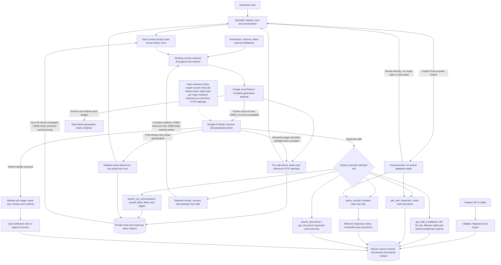

# Implemented copilot: request and context flow

Updated 17 October 2026. This describes the current code, including known gaps.
See the [interactive view](implemented-architecture.html), [Mermaid source](implemented-architecture.mmd),
and [complete source data map](data-map.md).

The current local configuration loads `challenge-dataset/test-data/dataset` and
selects Google `gemma-4-26b-a4b-it`. The sample import remains separately
selectable. The upstream checkout is at
`009e2b596782150f420021f9472ab37e3a2953ee`.

| Test dataset source records | Count |
| --- | ---: |
| Wells | 600 |
| Inspections | 125,198 |
| Maintenance jobs | 17,415 |
| Context notes before runtime additions | 1,887 |
| Documents | 4,449 |
| Users | 27 |
| Areas | 7 |
| Teams | 6 |
| Well types | 3 |

The test release defines field-data today as **15 January 2027**. Its new
records are imported into their own dataset namespace; identical sample well IDs
do not merge old conversations, notes or corrections into this version.

## Architecture

The existing diagram below predates the Q8 recall and private-preference tools.
The current request/tool/memory behavior is documented in the prose and tables
that follow; the diagram and interactive artifact have not been regenerated.



The Mermaid flow shows the available path. The model selects read tools. It can
also call `search_my_conversations` to retrieve the selected user's earlier chats
across sessions, using dates, keywords or a well ID and continuation pages.
Arrows to SQLite are local operations; SQLite does not go into the model prompt.

## What each request does

Fully specified correction commands now prepare a proposal locally: one exact
inspection, replacement field/value and reason. This path bypasses the model,
validates the target, and uses the same human review and confirmation boundary.
Ambiguous requests continue through Gemma. A write request that fails before a
valid proposal explicitly reports that no shared update was prepared or saved;
read-only status evidence cannot substitute for a correction. Request traces
show `correct_inspection` as `pending_confirmation`, then `saved` when confirmed.
The application performs the underlying SQLite inserts; generated SQL remains read-only.

Equipment replacement reports follow the model path: Gemma selects
`record_equipment_replacement`, Python validates and stages the proposal, and
the same user confirms before any shared write. This is separate from the local
parser for fully specified inspection corrections. A formatting instruction
uses `save_my_preferences`; an explicit private preference can be saved without
a shared-update confirmation because it changes only that user's presentation.

| Request | Intended tool flow | Evidence sent to the model | Current boundary |
| --- | --- | --- | --- |
| Is WELL-0001 producing? Who inspected it? | `get_well` | Latest inspection, computed classification, well ownership, crew notes, warnings and references | The model can instead choose SQL; SQL alone does not automatically include crew notes. |
| Rank wells by downtime in 2025 | `query_records` with an aggregate over `effective_inspections` | Complete aggregate results, not every inspection | Seven days per nonproducing weekly inspection is a model instruction; there is no SQL semantic validator. |
| What must we do about a spill? | `search_documents`, then `get_document` for the matching SOP | Relevant passages or the requested document, with line references | SOP retrieval is instructed, but no mandatory SOP gate currently enforces it. |
| Which Southwest Block 24 spills breached containment time in the last 90 days? | `get_spill_compliance(area="Southwest Block 24", days=90)` | Imported SR-02 containment rule, effective spill detections, linked reports and explicit elapsed containment times | Missing/conflicting rule or report evidence is unknown. Repair duration and reporting delay never substitute for containment time. |
| FYI WELL-0001 is under maintenance through 20 October | `add_shared_note` proposal, then human confirmation | Parsed well, text and dates in a concrete review | Confirmation saves an attributed claim. It does not rewrite readings or prove a restart. |
| This exact spill inspection was verified as rainwater | Find the inspection and relevant SOP; `correct_inspection` proposal; human confirmation | Original record, replacement value, reason and evidence | Accepted correction overlays exclude the spill in effective views. Competing values are disputed. Raw rows stay intact. |
| What were the three wells we discussed yesterday? | `search_my_conversations(period="yesterday")`, then cursor pages if needed | Only the selected user's saved messages across sessions in this dataset, with timestamps, IDs and private citations | The model chooses the tool and interprets the question; empty history cannot be reconstructed. Crew identity is a demo picker, not production authentication. |
| WELL-0333's recalled pump was swapped yesterday; count it as replaced | Gemma selects `record_equipment_replacement`; review; confirm | Well, operational date, direct/indirect evidence basis, actual reporter and any claimed source | A confirmed direct report affects subsequent recall reads. It creates a shared report and linked context note, not an invented work order. |
| Which recalled pumps are still in the ground? | `get_recalled_pumps`; use `my_area=true` and `include_install_cost=true` when requested | Effective recall notice, latest completed pump installations, applicable shared reports, installation-job costs and source locations | Hearsay remains unconfirmed and on the list. Current ESP wells are excluded. A scheduled check does not replace an installation. |
| Just for me, sort wells by area then ID and show costs in thousands | `save_my_preferences`; later `get_my_preferences` or automatic scoped preference loading | Only the selected user's enum-valued preferences and private provenance | Preferences persist across that user's conversations in the dataset and never become another user's defaults. |

## Retrieval: what happens today

1. Structured data uses SQL. The model sees table/column descriptions and requests
   a read-only query. Python executes it against a local snapshot of the selected
   dataset's public records. Aggregation runs before the 300-row output cap.
2. Documents use lexical retrieval. `search_documents` filters by dataset and
   optional well/type metadata, then scores keyword occurrences in the title/body.
   It returns the top five documents by default, with a passage around each best
   matching line. The model can read an exact document through `get_document`.
3. Shared context uses structured retrieval. `get_well` fetches fresh notes with
   author, date validity and correction status. Private history remains separate.
4. Private recall uses `search_my_conversations`, with optional local date bounds,
   literal keyword matching, a normalized well entity and role filtering. The
   server enforces the selected dataset and user across all sessions. Public SQL
   never receives chat rows. A compatibility `recent_my_conversations` shortcut
   still returns at most the latest 30 messages; it is not the dated recall path.
5. Spill containment compliance uses `get_spill_compliance`. One server-side read
   gathers the imported SR-02 protocol deadline, effective spill detections and
   reports linked through maintenance records. It extracts explicit elapsed
   containment hours from report text, classifies breaches/compliance/unknowns,
   and returns line-level SOP/report sources. It does not substitute repair time
   or reporting delay. Its default 90-calendar-day window ends on the evaluation
   date, so the sample default covers 19 July through 16 October 2026 inclusive.
6. Current recalls use `get_recalled_pumps`. It parses the supplier notice's
   positive lot list and reads explicit **Parts installed** statements from
   maintenance reports. The latest completed installation supplies model,
   serial, lot and source lines. Its matching maintenance job supplies the total
   installation cost. A later scheduled check or an interim job with a future
   planned finish is not silently treated as a completed replacement. Scoped
   shared replacement reports are read fresh on every call.
7. `user_preferences` persists structured sorting and cost-display choices by
   `(dataset_id, user_id)`, across conversations. Allowed values are loaded into
   the selected user's context. Recall rows also apply them deterministically:
   sorting by area then well ID and dividing cost by 1,000 when requested.
   General answer formatting remains the model's responsibility. Private
   preference sources identify the actual user and originating message when
   available; they are excluded from public SQL snapshots.

### Shared replacement reports and private preferences

`equipment_replacement_reports` stores the well, effective date, actual
`reported_by_user_id`, optional `claimed_source_user_id`, evidence basis,
statement, timestamp and linked context-note ID. It is accessed by scoped tools,
not copied into the model's public SQL schema. Confirmation writes the report
and its attributed `context_notes` backlink in one transaction.

A direct report has status `reported_replaced`. It removes an earlier recalled
installation from subsequent lists, with attribution and an explicit warning
that the work order is not independently verified. A newer installation is not
hidden by an older replacement report. A secondhand report has status
`unconfirmed`: Olivia saying "Nathan told me" remains Olivia's report with
Nathan as the claimed source. It does not masquerade as Nathan's direct
confirmation and does not silently remove that pump. This is a conservative
evidence policy, not an invented SOP role-authorization rule.

`get_recalled_pumps(my_area=true)` resolves the selected user's current
`team_id` against each well's own current `team_id`. The area default cannot
override a well's recorded team transfer. The result includes recall-rule,
installation-report, cost-record and shared-report provenance, plus the selected
user's preference provenance when applied.

Private recall uses runtime field-local TODAY and `COPILOT_FIELD_TIMEZONE`, never
the dataset analysis-as-of date. Standard periods (`today`, `yesterday`, `this
week`, `last week`) are resolved deterministically. Weeks start on Monday;
yesterday covers the complete preceding local day. Explicit `start_date` and
`end_date` include both named local days. Local-midnight boundaries are converted
to UTC and compared as exact integer microseconds using [start, end) intervals;
DST days may be 23 or 25 hours. Invalid or timezone-free stored timestamps are
excluded rather than assigned an invented timezone.

Operational reports use a separate clock. The local demo sets
`COPILOT_REPORT_DATE=2027-01-15`, so a replacement reported as "yesterday" means
**14 January 2027**. Without that override, new operational reports use the
runtime field-local date. Private conversation timestamps and dated history
search continue to use the actual runtime clock; simulated field dates must not
make today's private chat appear to have occurred in January.

History pages contain at most 30 messages, newest first, with a timestamp/ID
tiebreaker. Continuation cursors retain the original window, filters and maximum
visible message ID, so new messages do not shift a running search. Cursors are
bound to the selected user/dataset; all SQL predicates enforce that scope even
if a cursor is altered. A model must follow `next_cursor` while `has_more` is true
before claiming complete coverage, or disclose that its tool budget prevented
completion. Content is capped at 16,000 characters per retrieved message and
marks truncation. This is lexical retrieval, not semantic memory search.

This is retrieval-augmented generation in the broad sense: retrieve selected
evidence, then generate an answer. There is no embedding model, vector database,
semantic similarity search, graph database or GraphRAG implementation. An FTS5
index is populated during ingestion, but the active document search uses simple
Python keyword scoring, not that index or BM25. Relationships use SQL joins.

## What goes into one model request

At the start of `Copilot.respond`, the current user prompt is saved first. The
orchestrator loads **up to 16 available individual messages** from the selected
dataset, user and current conversation, including that prompt. These are user and
assistant messages, not 16 exchanges. New conversations can supply only one
message. A combined **12,000-character** budget prioritizes newer messages and
removes oldest context first; the oldest retained message may be partly shortened.
An omission notice tells the model to use dated private recall when needed.
The current user prompt is preserved in full up to the existing 20,000-character
input limit, even if it alone exceeds the history character budget. Full stored
history remains unchanged and searchable.

The number 16 is a provisional first-iteration limit, not a benchmark result or a
Gemma-specific capacity calculation. Recent history has no semantic relevance
filter; its character budget is distinct from the provider's measured token guard.

The history query runs **once per user request**, before the tool loop. Every
`client.complete(messages, definitions)` call resends the existing working
context: instructions, schema, generic domain rules, analysis date, field-local
TODAY and bounded recent history. Retrieval rounds also include tool definitions;
the final call omits them. Later rounds append the
assistant tool calls, selected tool results and server-issued source markers.
They do not send only the newest SQL result or fetch another 16 history messages.

| Model round | Input |
| --- | --- |
| First | Instructions + schema + dates + bounded recent private messages + tool definitions, unless configuration permits only a final call. |
| After a read | The same context + assistant tool call + bounded tool response and compact citations; dependent reads can be batched. |
| Third call, if needed | Retained context + bounded exchanges + final-answer instruction; tool definitions are omitted and further retrieval is disabled. |

The evidence panel shows tool provenance, **not the full model prompt**. Its SQL
and source list does not expose the private history sent with a request. The
token panel counts the serialized input without displaying its private text.
This implementation does not use a provider-side conversation ID to avoid
resending history.

Model-bound results strip raw JSON and image lists. Row lists are capped at 60,
other lists at 20, and strings at 6,000 characters. Citations sent to the model
use compact markers and source locations; full source metadata stays in the UI.
Serialized tool responses are bounded to 12,000 characters each and a shared
24,000-character budget across all tool responses in the model request. The
server redistributes this budget as tool exchanges accumulate. Truncation and
omissions are explicit; the model must disclose incomplete evidence coverage.
The backend retains up to 300 SQL rows for visuals, independently of these model
limits. Each response shows at most three visuals.

There is a hard maximum of **three model calls**, including final synthesis,
even if configuration requests more. Up to eight tool calls can be batched in a
retrieval reply. The final model call receives no tools and must answer from
retrieved evidence or disclose what remains unresolved. A provider returning a
tool call anyway cannot trigger a fourth model request. HTTP retries remain a
separate limit, described below.

Before the Q8 tools and preference context were added, the revised system context
measured 6,444 characters and 1,690 Google tokens,
down from 9,319 characters and 2,304 tokens with the same reference dates and
schema: reductions of 30.85% and 26.65%. This measurement covers the system
context at that historical revision, not the current expanded Q8 prompt. Each
real request also includes its available messages, tool definitions and any
retrieved evidence; the UI's measured per-call input count remains the current
evidence.

All 125,198 test inspections, and the separate 39,567 sample inspections, stay in
local SQLite. A SQL snapshot may copy all
public rows into local memory, but only selected outputs cross the model API.

## SOPs and rules: what is enforced

| Mechanism | Implemented behavior |
| --- | --- |
| Manual production threshold | Importer extracts the threshold and source quote from each well-type manual. Effective views classify the temperature difference using that threshold. |
| Formal false-spill correction | Imported formal context corrections and accepted runtime corrections overlay the raw detection. Effective spill counts/volumes exclude corrected false detections. |
| Conflicting correction values | Runtime conflicts become disputed; they are not silently applied. |
| Feedback classification | Typed corrections persist `feedback_kind`: temperature fields are `sensor_reading_correction`, spill detection is `ai_detection_feedback`, and spill area/volume are `ai_estimate_feedback`. Existing typed rows are migrated. Tags appear in review, fresh well context and correction citations; they never determine acceptance or create a type-wide learned rule. |
| Selecting effective views | The model is instructed to use them. Raw source tables remain queryable, so an incorrect model query can still choose raw values. |
| SOP/manual/report text in an answer | Tool selection retrieves text when the model requests it. A source reference alone is not proof that the complete document text was included. |
| Spill containment compliance | `get_spill_compliance` reads the imported SR-02 rule and linked reports in one tool call. It compares explicit containment hours, treats missing/conflicting evidence as unknown, and uses effective spill detections. This path includes the relevant SOP text and line-level report evidence. |
| Current pump recall | `get_recalled_pumps` reads affected lots from the imported supplier notice, identifies the latest completed installation, applies attributed direct replacement reports and retains indirect reports as unconfirmed. Original installation records remain intact. |
| Mandatory SOP/context coverage | Not implemented. There is no backend gate that requires a specific SOP section or fresh notes before every relevant answer. |

**Known citation-selection defect:** access to `well_types` automatically attaches
production-threshold manual references, including for spill-only queries against
the effective view. Those references do not support spill counts. The T350
reference currently starts on blank line 23, before the actual rule on lines
24–26. The spill SOP's false-positive section is the relevant policy evidence for
corrected spill statistics, but this mechanism does not automatically retrieve
it. These defects remain unfixed.

The next reliability improvement is a mandatory context step for applicable
questions: identify the well/type, fetch current notes and the relevant rule/SOP,
then permit the final answer. This is a proposal, not current behavior.

The source dataset's `operator_feedback` notes can already contain AI-estimate
feedback and conflicting opinions. They remain attributed context. The app does
not infer a formal accepted correction from that tag or free text. A verified
supported field correction requires an exact inspection, value and reason, then
human review; originals and the correction's accepted/disputed status stay linked.

The test dataset also adds typed `data_correction` notes, historical well types
and teams, operator status precedence, permanent closures and new SOP/MOC rules.
Optional source fields are preserved in `raw_json`, and team overrides import
correctly, but import success does not establish that all these historical and
procedural semantics are applied by every current view/tool. Imported typed
inspection corrections and effective-dated histories still need dedicated
semantic coverage. No claim is made that all 11 final questions are solved.

## Provider configuration and failure behavior

The current ignored local configuration selects the smaller Google Gemma route:

```dotenv
COPILOT_PROVIDER=google
COPILOT_MODEL=gemma-4-26b-a4b-it
COPILOT_DATASET_PATH=challenge-dataset/test-data/dataset
COPILOT_AS_OF_DATE=2027-01-15
COPILOT_REPORT_DATE=2027-01-15
GOOGLE_API_KEY=<set only in the ignored local .env>
```

Provider/model/key controls are absent from the UI. The sidebar contains only
dataset import controls. The OpenRouter adapter remains available with its own
separate key. Google credentials do not authenticate OpenRouter.
The built-in fallback settings still name the sample dataset and 31B model;
the values above describe the active local demo overrides.

For Q8, Google's 31B route returned HTTP 500. A separate live run on
`gemma-4-26b-a4b-it` completed Nathan's first turn in two model rounds with
**3,674 then 7,188 input tokens**, preparing the replacement review proposal.
This validates the initial model-selected write path, not all five live Q8
turns. A later OpenRouter check of `google/gemma-4-31b-it:free` returned
HTTP 429 on its first attempt in 5.8 seconds, with one logical round, no tool
execution, no pending update and unavailable token usage. Local configuration
remains on Google 26B. These checks do not establish a provider-wide outage.

Earlier live Google tests returned HTTP 500 (INTERNAL); OpenRouter's free 31B and
26B routes returned upstream HTTP 429. A later real-user spill-heatmap request
completed two Google Gemma 31B model rounds and produced the heatmap. Its stored
provider input counts were 3,556 then 7,135 tokens. This supersedes the earlier
statement that live generation was wholly unverified; it does not validate every
challenge scenario or establish continued provider availability.

A later metadata-only OpenRouter quota check returned 0 daily free requests used,
50 allowed and 50 remaining. Its earlier upstream 429 did not establish an
exhausted daily allowance. This was not a generation request.

The exact Southwest Block 24 containment question subsequently completed through
two live Google calls with the revised prompt, budgets and compliance tool:
3,109 and 7,197 input tokens from returned usage metadata, with one generation
HTTP attempt each. It used `get_spill_compliance` and correctly identified
WELL-0082 (7.1 hours) and WELL-0100 (8.1 hours) as exceeding the imported SR-02
four-hour deadline. It completed in 73.3 seconds without a partial-response flag.
The tool's complete public sample window contains ten effective spill detections
and these two breaches; this verifies that question, not every possible query.

The earlier diagnostic of this question grew from 3,504 to 9,722 to 18,862 input
tokens; its third call timed out after two HTTP attempts within the 90-second
budget. The user's earlier one-call screenshot was a separate HTTP 500 failure.
An available preflight token count therefore did not establish successful
generation or prove a quota rejection.

## Complete input token accounting

Before each Google generation call, the adapter submits its actual complete
payload through `countTokens.generateContentRequest`: system instructions, schema,
history, tools, tool results and retrieved document/SOP text. One bounded counting
request is made per model round. It is not repeated for inference retries.
`usageMetadata.promptTokenCount` replaces the preflight count when returned.
Output, cache, thought and other provider token fields are preserved when supplied.

When the preflight count exceeds `COPILOT_MAX_INPUT_TOKENS` (default 12,000),
the adapter stops locally before sending a generation request and preserves a
specific input-budget error. Failed token counting still allows generation, so
this is a guard for known counts, not an unconditional token-budget guarantee.
It does not measure current project TPM, reserve quota or pace requests. Several
requests below the per-request budget can still exceed a shared TPM allowance.

The UI displays the latest input context, the peak context for that response and
the number of model calls. A peak is the largest single input window, not the sum
of repeated calls. Summed inputs describe repeated input across calls, rather
than the size of one context window. Per-call details distinguish preflight
versus returned usage and show generation HTTP attempts. A failed or unsupported count is marked
Unavailable rather than estimated or converted to zero. Counts survive failed
generation and are stored with the selected user's private response. A preflight
count does not prove billed usage or successful generation. A tokenization-only
live static test returned 59 tokens, without asking the model to generate an answer.

## Visual verification without model calls

Visual preview directly executes six preset, read-only database views: status,
temperature trend, downtime ranking, corrected-spill heatmap, map and table.
The explicit Show preview button runs the selected read; unrelated reruns do not.
It uses the same renderers as chat responses and writes no conversation. This
tests data/visual rendering, not model planning. Map background tiles can still
use network access independently of any model API.

Transient HTTP/network inference failures use at most three HTTP attempts within
each inference call's timeout budget. A 429 or invalid key is not retried. These
attempts are separate from model rounds and the one-per-round countTokens call.
If a follow-up explanation fails, returned records and sources remain visible as
a partial response. If a transient failure occurs before any read, an exact well
ID can trigger a bounded local `get_well` lookup. A 429 permits this same local
read without another inference request. Reports are never saved through
that fallback. Complex questions still need a working model.

## Latest verification boundary

The latest recorded full offline suite has **149 passing tests**, including
three scripted Q8 integration checks against the real test dataset. These checks
cover shared replacement persistence, private preference isolation and hearsay
attribution with simulated provider replies. They do not consume model quota.
A subsequent one-HTTP-attempt regression was added and all 21 targeted model
tests passed. Only Nathan's initial Q8 replacement proposal has been verified
live on the current Google 26B route; the complete live four-session/five-turn
sequence and all 11 final questions remain unverified.
