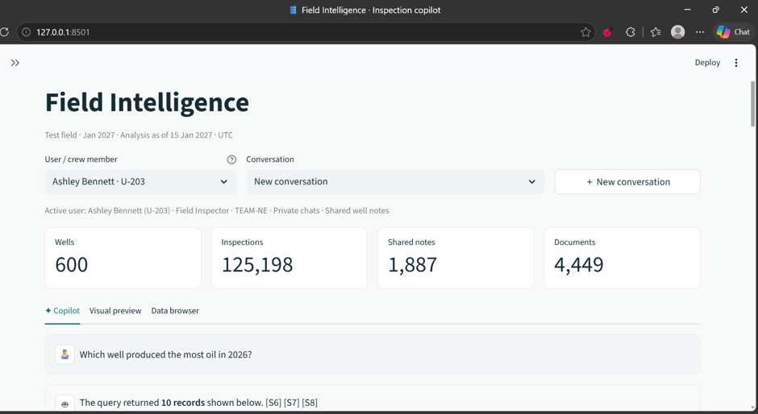
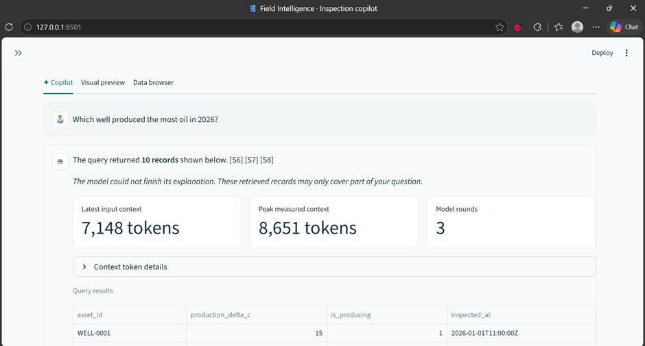
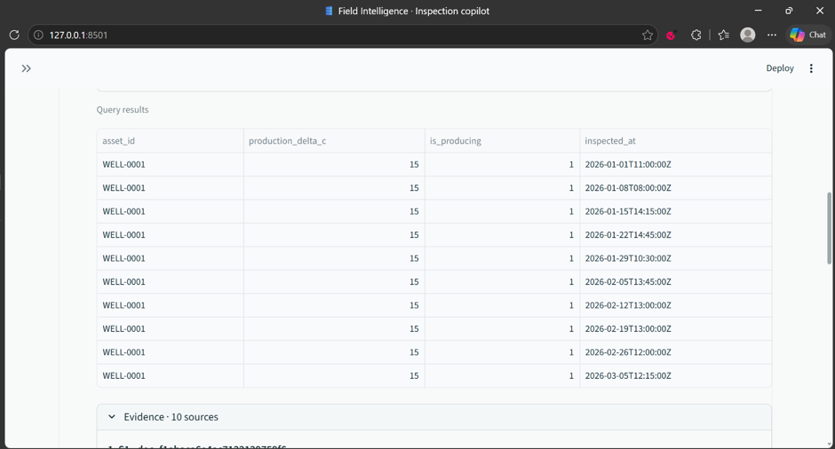
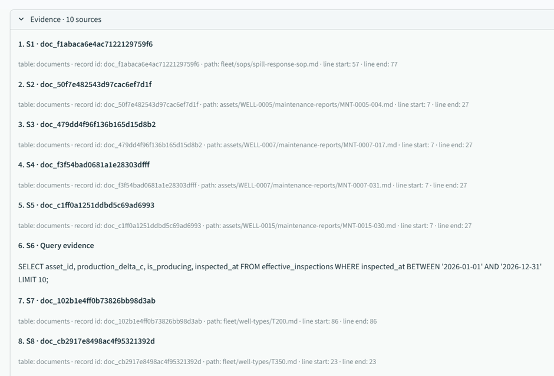
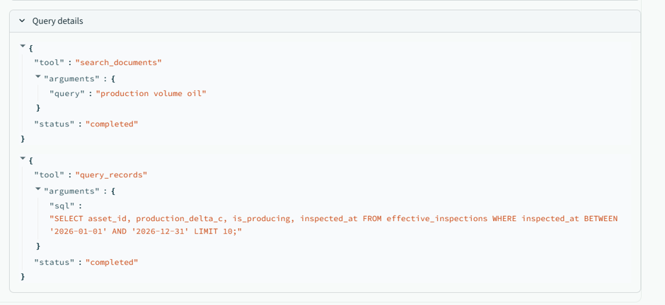
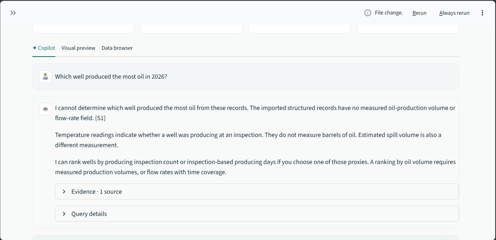

# Field Intelligence: system design and failure report

Prepared on **17 October 2026**. The test dataset uses **15 January 2027** as its operational date.

This report uses simple technical English inspired by ASD-STE100. It does not claim formal ASD-STE100 compliance.

The copilot stores field records and memory in one SQLite database. Python controls retrieval and writes. Gemma selects tools and explains results.

## 1. System components

| Component | Function |
|---|---|
| Streamlit | Displays the chat, user picker, dataset import, sources, tables, and token counts. |
| Python agent | Builds each model request, executes tools, and controls the maximum number of model rounds. |
| SQLite | Stores imported records, documents, shared reports, corrections, private chats, and preferences. |
| Google Gemma | Interprets the message, selects tools, and produces an answer or a proposed update. |
| Provider adapter | Sends requests to Google or OpenRouter. Counts input tokens and records provider errors. |
| Source files | Preserve the original dataset files. Database records retain source paths and line numbers where available. |

The local route uses Google `gemma-4-26b-a4b-it`. Earlier Google 31B and OpenRouter checks returned HTTP 500 and 429 respectively.

The imported test dataset contains 600 wells, 125,198 inspections, 17,415 maintenance records, 1,887 context notes, 4,449 documents, and 27 users. The model does not receive all these records in each request.

## 2. Request sequence

1. The operator selects the dataset, user, and conversation.
2. Python loads the permitted private history and saved preferences.
3. Python adds instructions, dates, schema information, and tool definitions.
4. Gemma requests relevant records or documents through tools.
5. Python validates the arguments and executes the tools.
6. Gemma receives the tool results and answers, requests more evidence, or proposes an update.
7. Streamlit displays the answer, sources, tool trace, token counts, and applicable table.

Local field-correction and unsupported-volume checks can finish without Gemma.

The application permits **up to three logical model rounds** per user message. Multiple tools can execute after one response. The last round cannot request more tools.

A second round resends context with tool results. A third round can resolve a missing prerequisite. Repeated retrieval increases latency and input-token use.

An HTTP retry is another generation attempt inside one logical round. A Google `countTokens` request is also a separate API request. The UI must distinguish model rounds, generation attempts, and token-count requests.

## 3. Memory stays in one database

The database file is `data/copilot.sqlite3`. Memory scopes use separate tables and query filters inside this file.

| Memory or evidence | Main tables | Access scope |
|---|---|---|
| Original field evidence | `inspections`, `maintenance`, `equipment`, `regulatory_events`, `documents` | Selected dataset |
| Shared well context | `context_notes` | Selected dataset and relevant well |
| Reviewed field corrections | `corrections` | Selected dataset and target inspection |
| Shared pump replacement reports | `equipment_replacement_reports` | Selected dataset and well |
| Private conversation history | `chat_messages` | Selected dataset, user, and conversation; history search can span that user's conversations |
| Private display preferences | `user_preferences` | Selected dataset and user |
| Unconfirmed review proposals | `pending_updates` | Selected dataset, user, and conversation |
| Local API scheduling | `model_token_reservations`, `model_rate_limit_cooldowns` | Provider, model, and configured project label |

See the [application schema and memory relationships](docs/application-schema.md) for the table links.

`dataset_id` separates imported datasets. `user_id` separates private memory. `session_id` identifies a conversation. Python supplies these values from the selected application state. The model cannot choose another user for private-history tools.

Shared reports become available to other users after confirmation. Private preferences save after an explicit personal instruction. A new conversation does not erase either form of persistent memory.

For example, Nathan's confirmed replacement report can affect Robert's recall answer. Nathan's preference for costs in thousands of dollars applies only to Nathan.

Original inspection readings remain preserved. Accepted runtime corrections affect the effective inspection view. A source note records the author and reason. Ordinary feedback does not automatically become an accepted correction.

The SQL tool receives a temporary snapshot of public tables from the selected dataset. Private memory is excluded. The demonstration user picker requires authentication and server-side authorization before production deployment.

## 4. Retrieval and SOP use

Structured questions use SQL joins and calculations. Document questions use lexical search: the tool matches words in manuals, SOPs, and reports. The current application does not use vector embeddings or a graph database.

General questions depend on Gemma selecting the relevant document tool. The spill-compliance tool retrieves the applicable SOP rule as part of its operation. The recall tool combines the supplier notice, installation reports, and shared replacement reports. There is no mandatory SOP check for every possible question.

A spill SOP supports a spill deadline. It cannot establish produced-oil volume.

## 5. What the supplied screenshots show

The first five screenshots document the earlier run. Image 6 shows the result after the changes. All six images are copied without modification.

### Image 1: dataset and question

The question asks: **“Which well produced the most oil in 2026?”** A valid ranking requires oil quantities or an agreed estimate.

### Image 2: incomplete answer and token counts

The answer says the model could not finish its explanation. The UI shows **7,148 latest input tokens**, **8,651 peak input tokens**, and **three model rounds**. Latest and peak are individual request measurements. Neither value is the total input sent during one minute.

The screenshot does not show all three input counts, request times, or the provider error. It cannot establish whether TPM, RPM, an HTTP 500, or another condition stopped this run.

### Image 3: rows that do not answer the question

The table contains ten inspection rows for WELL-0001. `production_delta_c` is the manual's temperature-difference threshold. `is_producing` is an inspection-based classification. Neither field measures barrels of produced oil. Producing-inspection counts are only a proxy.

### Image 4: sources with limited relevance

The evidence includes a spill SOP, maintenance reports, manuals, and SQL. The displayed passages do not establish annual oil-production volume. Ten citations cannot establish an unsupported conclusion.

### Image 5: the retrieval path

The trace first searches documents for `production volume oil`. It then selects inspection fields for 2026 with `LIMIT 10`. The query has no aggregation or ranking. It cannot select the well with the largest annual quantity. The date comparison also uses a date-only upper bound against timestamps, which can exclude records on 31 December.

The correct response is: **“The verified schema does not contain measured oil-production volume. I cannot identify the highest producer from these inspection records. I can compare a defined inspection-based proxy if you choose one.”** Spill-volume estimates must not be treated as produced-oil volume.

## 6. Rate limits and the earlier design gap

Google defines TPM as **input tokens per minute**. Google applies rate limits per project. Limits vary by model and account tier. The operator reported a **16,000 TPM** allowance; this is not a universal Google limit. See [Google's rate-limit documentation](https://ai.google.dev/gemini-api/docs/rate-limits).

The earlier application checked a **12,000-token maximum for each request**. It did not check the combined requests inside a minute.

For example, one call can send 6,000 input tokens. A second call can send 11,000 input tokens soon afterward. Each call passes the local 12,000-token check. Together, the calls send 17,000 input tokens. That total can exceed a 16,000 TPM allowance.

Earlier weaknesses were:

- The application did not coordinate token use across users and conversations.
- Retries could send the same large input again.
- Repeated schema text, tool definitions, history, and evidence increased later requests.
- A broad document search returned weakly relevant passages.
- The SQL result did not satisfy the requested comparison.
- Fallback output exposed partial records without completing the requested analysis.

Rate control and answer correctness are separate problems. Waiting can prevent some rate-limit errors. Waiting cannot make the displayed SQL answer the production-volume question.

## 7. Optimization work and validation status

**All 183 offline tests passed in 332.741 seconds.** This total includes nine UI tests. The checks made no live generation requests.

A persistent SQLite ledger now coordinates all application users and conversations. Reservations use the provider, model, and configured project label. The ledger stores no prompts, keys, or user identifiers.

The default working budget is **14,500 input tokens per local 60-second window**. This leaves **1,500 tokens** below the reported 16,000 limit. Each generation attempt reserves `ceil(input_tokens × 1.10) + 64` tokens. Retries reserve separately. Failed attempts retain their reservations until expiry.

If the budget is unavailable, the request waits up to 180 seconds. The UI displays the queue state and wait duration. Queue time does not consume the generation timeout. HTTP 429 creates a shared cooldown without an automatic retry. Unknown input counts and oversized reservations stop before generation.

The context changes select a smaller tool catalogue and omit SQL schema when SQL is unavailable. They reduce recent history from 12,000 to 6,000 characters. Tool evidence has an 8,000-character limit per result and a 12,000-character combined limit. Complete compound-tool results normally allow read questions to finish in two model rounds.

For a recall read, the first serialized request fell from **14,674 to 3,027 characters**: a **79.4% reduction**. The catalogue fell from 13 tools to one. These are character measurements, not token measurements or a universal reduction guarantee.

A local capability check now handles the pictured oil-volume question before a model request. It checks structured columns and optional source fields. If no measured production field is available, it returns a sourced explanation of the missing data. If a possible measurement exists, normal retrieval continues.

The local ledger cannot observe requests from AI Studio or other programs. Google can still reject a request because of external use, RPM, daily limits, or provider capacity. This is local scheduling, not a reading of Google's remaining quota.

The suite checks memory isolation, controlled writes, source retention, pacing, context reduction, and UI behavior. The first five images document the earlier run. Image 6 shows one result after the changes.

## 8. Result after optimization

The same question now produces a data-limit explanation. The answer identifies the missing production-volume or flow-rate field. It separates temperature-based status from produced-oil volume and spill volume. It offers inspection-based comparisons as explicit proxies. The response cites one coverage source, S1. It does not present an unsupported ranking.

The implemented local capability check produces this response without a generation request. Code and offline tests establish that behavior. This screenshot does not show a token counter. It does not prove that TPM pacing works for every request. Pacing is verified separately through the tests in section 7.

## 9. Demonstration boundaries

Q8 tests shared reports, private preferences, and attribution. It does not validate all eleven final questions. Shared writes require confirmation. Secondhand statements retain the actual reporter and the claimed source.

Private-history dates use the real clock in the configured field timezone. Benchmark operational dates use the evaluation date. Thus operational “yesterday” means 14 January 2027.
